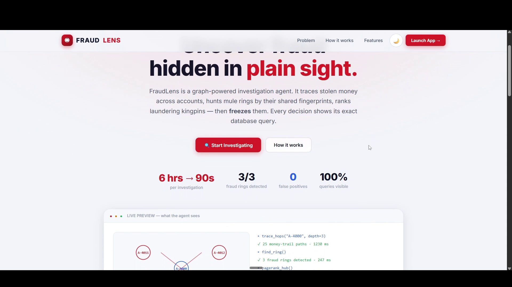
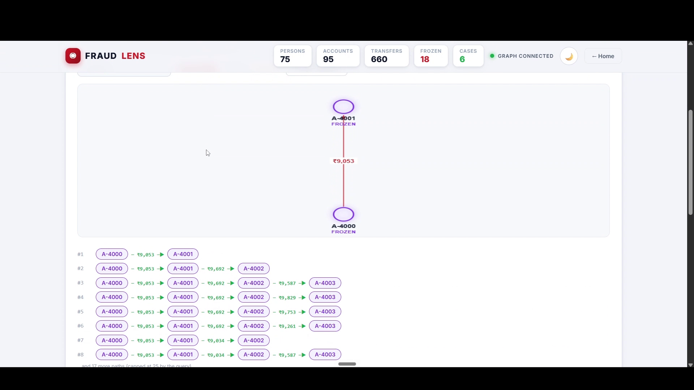
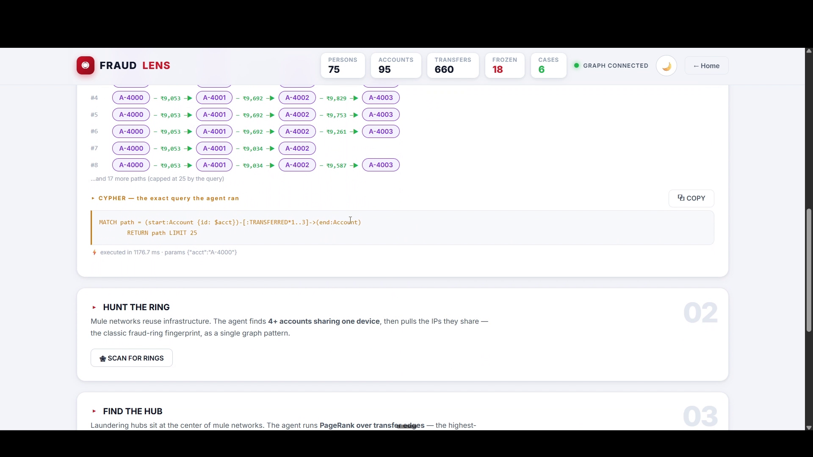
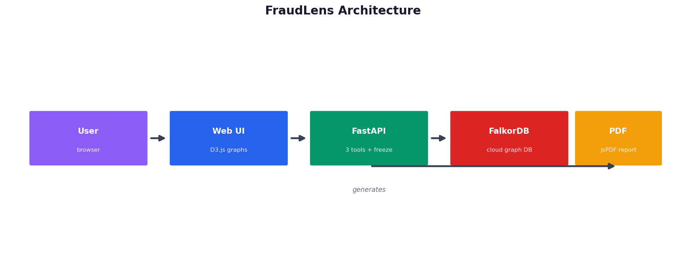
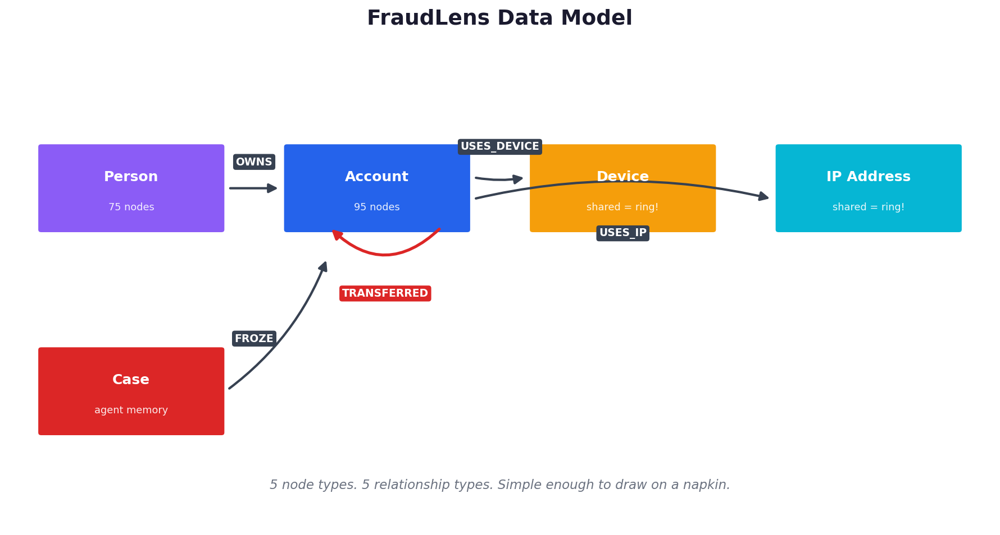

# FraudLens


**Graph-powered fraud investigation agent that traces, hunts, and freezes mule networks.**

🔗 **Live Demo:** https://fraudlens-y5ba.onrender.com/
📺 **Demo Video:** coming soon
📝 **Blog Post:** coming soon

---

## Screenshots

### Landing Page


### Trace the Money — 25 money trails from A-4000


### Hunt the Ring — 3 fraud rings detected


---

## The Problem

Banks lose **$40B+ every year** to mule-account fraud rings. Criminals open 50 fake accounts, push ₹9,000 through each (just under the reporting limit), and vanish.

A human analyst takes **4–6 hours per account** — manually tracing transfers through spreadsheets. Today's dashboards only send alerts. They watch the crime. They never stop it.

## The Solution

FraudLens is an **agent**, not a dashboard. Give it a suspect account, and it:

1. **Traces** — follows money across multi-hop paths in the graph (25 trails in seconds)
2. **Hunts** — finds fraud rings by shared device/IP fingerprints (3/3 rings detected)
3. **Ranks** — runs PageRank to find the kingpin (zero labels needed)
4. **Freezes** — locks the accounts and writes a case file **into the graph**

Every tool shows its exact Cypher query. No black box.

---

## Architecture



```
User → Web UI (D3.js) → FastAPI → FalkorDB Cloud
                              ↓
                     PDF Report (jsPDF)
```

- **Frontend:** Vanilla JS + D3.js force-directed graphs, dark/light mode, mobile responsive
- **Backend:** FastAPI with 3 read-only tools (regex write-guards) + 1 write endpoint (freeze)
- **Database:** FalkorDB Cloud — native graph traversals, Cypher queries in milliseconds

## Data Model



| Node | Relationships |
|------|---------------|
| Person | —OWNS→ Account |
| Account | —TRANSFERRED→ Account (amount, timestamp) |
| Account | —USES_DEVICE→ Device, —USES_IP→ IP |
| Case | —FROZE→ Account (investigation memory) |

Seeded: **75 persons, 95 accounts, 660 transfers, 3 fraud rings** (5 mules each, ₹9,000–₹9,900 structuring amounts).

---

## The 3 Tools + 1 Action

| Tool | What it does | Cypher pattern |
|------|--------------|----------------|
| `trace_hops` | Multi-hop money trail | `MATCH path = (a)-[:TRANSFERRED*1..3]->(b)` |
| `find_ring` | Shared device/IP rings | `MATCH (a1)-[:USES_DEVICE]->(d)<-[:USES_DEVICE]-(a2)` |
| `pagerank_hub` | Kingpin ranking | PageRank over `TRANSFERRED` edges |
| `freeze` | **The agent acts** — freeze + case file | `SET a.frozen=true` + `CREATE (c:Case)-[:FROZE]->(a)` |

### Safety Rails
- 3 investigation tools are **read-only** (regex blocks `SET`/`CREATE`/`DELETE`)
- Freeze is the **only** write path, with staged confirmation
- Every query displayed in the UI — fully auditable

---

## Quick Start

### Try the live demo (no setup)
Open https://fraudlens-y5ba.onrender.com/ → type `A-4000` → Investigate.

### Run locally

**Prerequisites:** Python 3.11+, a FalkorDB instance ([FalkorDB Cloud](https://falkordb.cloud) free tier works).

```bash
# 1. Clone
git clone https://github.com/Mohiit70/fraudlens.git
cd fraudlens

# 2. Install
pip install -r requirements.txt

# 3. Configure FalkorDB connection
export FALKOR_HOST="your-instance.falkordb.cloud"
export FALKOR_PORT="6379"
export FALKOR_USER="falkordb"
export FALKOR_PASSWORD="your-password"

# 4. Seed the database (idempotent — safe to re-run)
python seed.py --verify

# 5. Run the app
python -m uvicorn app:app --host 0.0.0.0 --port 8000
```

Open http://localhost:8000 → type `A-4000` → Investigate.

### Deploy to Render
Click **New Web Service** → connect this repo:
- **Build:** `pip install -r requirements.txt`
- **Start:** `uvicorn app:app --host 0.0.0.0 --port $PORT`
- **Env vars:** `FALKOR_HOST`, `FALKOR_PORT`, `FALKOR_USER`, `FALKOR_PASSWORD`

---

## Track Mapping

**Track 01 (Primary): Agents That Act on Connected Data** — the freeze action writes to the graph; the agent doesn't just analyze, it acts.

**Track 02 (Secondary): Agent Memory and Coordination** — `Case` nodes persist investigations in the graph, building cross-session memory.

---

## Tech Stack

Python · FastAPI · FalkorDB (Cypher) · D3.js · jsPDF · Render

## AI Disclosure

Built with AI assistance for code, UI design, and documentation. The architecture, Cypher queries, and fraud-detection logic are the author's own design. I can explain every query in this repo.

## License

MIT © 2026 Mohit Bisht
